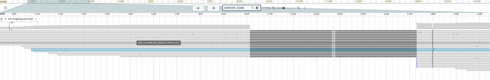
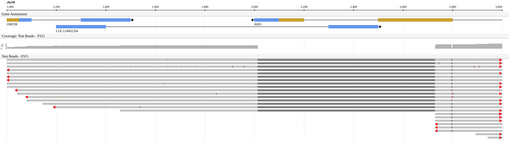
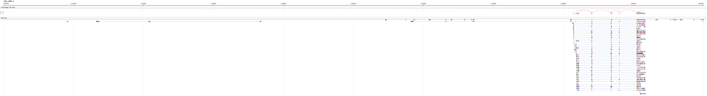
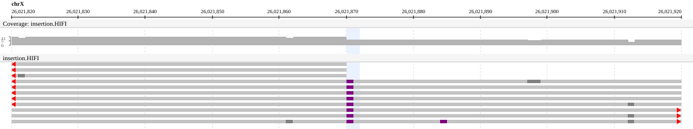
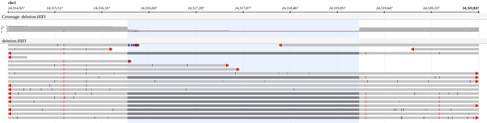
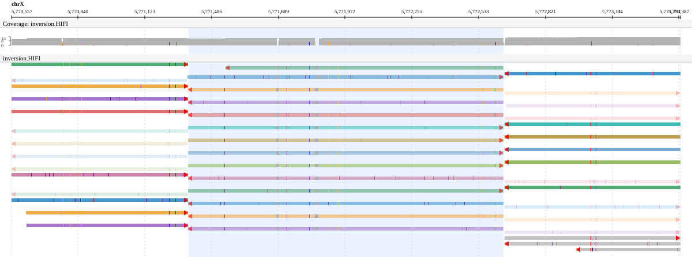
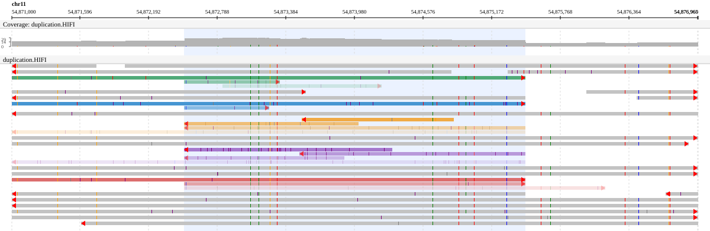
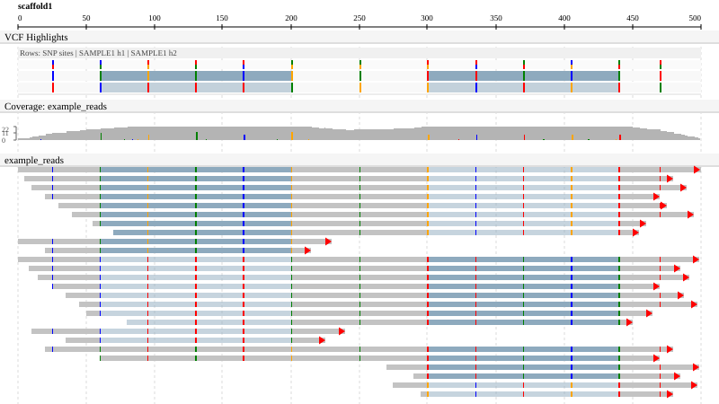

# BamSnap-LRS
v2.0 [](https://doi.org/10.5281/zenodo.23277809)

**A static genome browser for long-read sequencing data**

BamSnap-LRS is a command-line tool for generating snapshots of BAM/CRAM alignments. It supports DNA and RNA long reads, structural-variant (SV) regions, and VCF-guided SNV highlighting. Figures are rendered as SVG and can also be exported as PNG or PDF, without requiring a web browser or server.

> **Scope:** BamSnap-LRS focuses on genomic intervals within a shared reference assembly. It does not provide a dedicated cross-chromosome translocation/breakend (BND) viewer.

## Contents

- [Key Features](#-key-features)
- [Installation](#-installation)
- [Input files and indexes](#input-files-and-indexes)
- [Quick Start](#-quick-start)
- [Command Reference](#-command-reference)
- [Visual Elements](#-visual-elements)
- [Limitation](#-Limitation)
- [Advanced Usage](#-advanced-usage)
- [License](#-license)
- [Acknowledgments](#-acknowledgments)

## ✨ Key Features

###  Visualization
- Read pileups, coverage and base-composition tracks, genomic axes, and nucleotide-colored mismatches.
- Static, customizable figures suitable for batch workflows.

### Long-Read Support
- PacBio HiFi and ONT BAM/CRAM alignments.
- Optional supplementary/secondary alignments; records sharing a read name are grouped and colored by alignment order.
- Multiple BAM/CRAM files shown as separate tracks on the same reference coordinates.

### Structural Variant Snapshot Support
- Batch snapshots from BED or VCF regions, including INS, DEL, INV, and DUP examples.
- Automatic flanking windows and shaded target intervals; override padding with `--padding`.

### VCF Highlight Mode
- Highlights **SNVs** from a VCF.
- Groups reads by phase-block-specific haplotype signatures and colors informative read segments.
- Mutes non-target alignment differences; provides read-assignment summaries in the console.

### Gene and Feature Annotation
- GFF/GTF gene or transcript models (`--gff-display gene|transcript`) and BED features.

### Variant Visualization
- Resolves mismatches using a reference FASTA, enabled `cs` or `MD` tags, or explicit CIGAR `=`/`X` operations.
- Shows insertions, deletions, orientation, and RNA splice/reference-skip events.

### Multiple Output Formats
- **SVG** (native), **PNG**, and **PDF** (both converted from SVG using CairoSVG).

## 📦 Installation

### Requirements
- Python 3.8+
- [`pysam`](https://pysam.readthedocs.io/) and [`CairoSVG`](https://cairosvg.org/), installed from `requirements.txt`
- Optional: `pyfaidx` for indexed FASTA access; a built-in uncompressed-FASTA reader is used if unavailable


### Install from source

```bash
git clone https://github.com/comery/BamSnap-LRS.git
cd BamSnap-LRS
pip install -r requirements.txt
chmod +x bin/BamSnap-LRS
```

Run commands from the repository root with `python bin/BamSnap-LRS` (or `./bin/BamSnap-LRS`).

## Input files and indexes

| Input | Usage | Supported files | Index required? |
| --- | --- | --- | --- |
| BAM / CRAM | `--bam` | Coordinate-sorted `.bam` / `.cram` | **Yes** — BAM: `.bai` or `.csi`; CRAM: `.crai` or `.csi` |
| BED | `--bed`, `--regions` | `.bed`, `.bed.gz` (gzip/BGZF) | **No** (`.tbi`/`.csi` not needed) |
| GFF / GTF | `--gff` | `.gff`, `.gtf`, `.gff.gz`, `.gtf.gz` (gzip/BGZF) | **No** (`.tbi`/`.csi` not needed) |
| VCF | `--regions`, `--highlight-vcf` | `.vcf`, `.vcf.gz` (gzip/BGZF) | **No** (`.tbi`/`.csi` not needed) |
| Reference FASTA | `--fa` | **Uncompressed** `.fa`, `.fasta`, etc. | **No** pre-existing `.fai` required for plotting |

BAM/CRAM inputs are retrieved by genomic interval and must be indexed. BED, GFF/GTF, and VCF files are read sequentially, so compression is supported without a tabix index. For compressed region/VCF files, use the `.gz` suffix (for example, `regions.bed.gz` or `variants.vcf.gz`).

`--fa` is recommended for CRAM decoding. All alignment and annotation files must use the **same reference assembly and matching contig names** (for example, `chr1` is not automatically mapped to `1`). Multiple BAM/CRAM files become separate tracks, labeled by filename without extension unless `--track-title` is supplied; sample names are not inferred from BAM read-group metadata.

**Coordinates:** BED uses 0-based, half-open intervals; GFF/GTF and VCF use their native 1-based coordinates and are converted internally. `--pos chr:start-end` is interpreted as `[start, end)`; `--pos chr:pos` displays a window of up to 500 bp around the specified coordinate.

## 🚀 Quick Start

### Basic Usage (DNA)

```bash
python bin/BamSnap-LRS dna \
    --bam example/sim.mapping.sort.bam \
    --pos chrM:1000-3000 \
    --fa example/chm13v2.chrM.fasta \
    --show-axis \
    --out snapshot.svg
```

### RNA Analysis

```bash
python bin/BamSnap-LRS rna \
    --bam example/rna/test.rna.bam \
    --pos Cdec_SDR_X:200000-300000 \
    --out rna_snapshot.svg \
    --show-axis
```

RNA mode displays spliced alignments and splice-junction arcs.

### Batch Region Plotting from BED/VCF

```bash
python bin/BamSnap-LRS dna \
    --bam example/sim.mapping.sort.bam \
    --regions example/test_regions.vcf \
    --out-prefix example/batch.svg \
    --fa example/chm13v2.chrM.fasta \
    --show-axis
```

Batch mode requires `--regions` and `--out-prefix`. Outputs are named `<prefix>_<chrom>_<plot-start>_<plot-end>.<format>`; `plot-start` and `plot-end` represent the actual plotting area, include any automatic or user-specified padding.

### Structural Variant Snapshot Example

```bash
python bin/BamSnap-LRS dna \
    --bam example/SV_show/insertion.HIFI.bam \
    --bam example/SV_show/insertion.ONT.bam \
    --bam example/SV_show/insertion.Cyclone.bam \
    --regions example/SV_show/insertion.vcf \
    --out-prefix example/SV_show/insertion.svg \
    --show-axis \
    --show-supp
```

Use `--show-supp` to display supplementary alignments, particularly useful for inversions and duplications.

### VCF Highlight Example

```bash
python bin/BamSnap-LRS highlight \
    --bam example/highlight/sample1.hignlignt.bam \
    --bam example/highlight/sample2.hignlignt.bam \
    --pos chr21:20462000-20467000 \
    --highlight-vcf example/highlight/region_chr21.vcf \
    --out example/highlight/highlight.svg
```

For phased read coloring, provide a VCF with phased `GT` (`|`) and phase-set `PS` information.

## 📖 Command Reference

### `dna` / `rna` — Generate genome snapshots

| Option | Description | Default |
| --- | --- | --- |
| `--bam` | One or more indexed BAM/CRAM files | Required |
| `--pos` | Single genomic position, `chr:start-end` or `chr:pos`. Mutually exclusive with `--regions`. | - |
| `--regions` | BED or VCF file for batch plotting. VCF records support SV-style intervals. Mutually exclusive with `--pos`. | - |
| `--out` | Output file path for single-region mode (`.svg`, `.pdf`, `.png`). | required with `--pos` |
| `--out-prefix` | Output prefix for batch mode. Output files are named by prefix plus genomic interval. | required with `--regions` |
| `--padding` | Manually set padding on both sides of each BED/VCF region. If omitted, padding is inferred automatically. | auto |
| `--fa` | Reference FASTA (uncompressed) | None |
| `--mapq` | Minimum mapping quality | `0` |
| `--show-supp` / `--show-secondary` | Include supplementary / secondary alignments | Off |
| `--width` | Image width in pixels. | 1200 |
| `--read-height` | Height of each read in pixels. | 6 |
| `--detail` | `low`, `mid`, `high` (higher levels show more alignment detail/indel labels) | `mid` |
| `--overview-detail` | `hide` or `show` small differences in wide genomic windows | `hide` |
| `--use-md` / `--use-cs` | Use MD / cs tag to detect mismatches. | Off |
| `--show-axis` | Show genomic coordinate axis | Off |
| `--show-coverage` / `--no-coverage` | Show / hide coverage track | On |
| `--coverage-height` / `--coverage-max-depth` | Coverage track height / plotted depth limit | `15` / auto |
| `--show-composition` | Add base-composition chart | Off |
| `--comp-height` / `--comp-max-depth` | Composition chart height / depth limit | Auto |
| `--track-title` | Custom title(s) for BAM/CRAM tracks | Filename stem |
| `--gff` / `--bed` | Gene annotation / BED annotation (mutually exclusive) | None |
| `--gff-display` | `gene` (collapsed) or `transcript` (individual models) | `gene` |
| `--style` | `jbrowse` or `default` | `jbrowse` |
| `--color-by` | `type`, `base`, `strand`, or `mapq` | `type` |
| `--hide-insertions` | De-emphasize insertion marks and labels | Off |
| `--show-insertion-labels` / `--no-insertion-labels` | Enable / disable insertion labels | On |

Reads are displayed without an additional read-downsampling limit.

### `highlight` — Highlight VCF SNVs on reads

`highlight` accepts the common options above, plus:

| Option | Description | Default |
| --- | --- | --- |
| `--highlight-vcf` | VCF with target SNVs | Required |
| `--highlight-samples` | Select VCF samples | All samples |
| `--no-hap-sort` | Disable phase-signature read clustering | Off (clustering on) |
| `--no-hap-filter` | Keep reads without highlighted-site overlap | Off (filtering on) |
| `--hap-layout` | `packed` (reuse non-overlapping rows) or `row` (one alignment per row) | `packed` |

Highlight mode defaults to `--detail high` and enables the coordinate axis. Only SNVs are visualized in this mode; indels and other non-SNV records are not drawn as highlight sites.

## 🎨 Visual Elements

### Coverage Track
Read depth and nucleotide composition: reference-matching bases are gray; non-reference A/C/G/T are red/blue/green/orange.

### Read Track
Gray read bodies indicate aligned matches; colored blocks show mismatches; purple marks show insertions; dark gray spans mark deletions. Thin lines indicate reference skips, with splice arcs in RNA mode. Arrowheads indicate alignment strand. At broad scales, small differences are simplified by default; `--overview-detail show` retains them.

### Split-Read Coloring
Visible alignments with the same query name share a group color. Opacity follows their inferred order along the original read, making split alignments easier to trace.

### Structural Variant Focus Region
A pale background marks the BED/VCF target within its padded plotting window. By default, small variants and insertions receive compact flanks, while longer variants receive wider flanks.

### VCF Highlight Track
Shows target SNVs and per-sample REF/ALT or haplotype alleles. Phased genotypes with `GT` and `PS` are grouped into phase blocks; haplotypes within a sample are distinguished by opacity.

### Highlight-Aware Read Track
Only bases at highlighted SNVs retain nucleotide-specific colors; unrelated mismatches and indels are muted. Reads are clustered by **phase-block-specific signatures**: `h1`/`h2`/... for unique assignments. A read may have different assignments in different blocks; ambiguous regions remain gray. Console `[HIGHLIGHT-SUMMARY]` lines report assigned, complex, unassigned, and non-informative read counts per track/region.

### Coordinate Axis
Genomic tick labels and guide lines, enabled with `--show-axis` (on by default in Highlight mode).

### Gene Annotation Track
GFF/GTF gene models show exons, CDS, and strand; `--gff-display transcript` separates transcript isoforms.

### BED Annotation Track
`--bed` draws BED features, including block structures from BED12 where present.

## Limitation
- the current SV visualization is intended for intra-chromosomal events such as INS, DEL, DUP, and INV. Dedicated translocation / breakend cross-chromosome visualization is not currently supported.
- BamSnap-LRS did not consider duplicate names caused by BAM merging nor use SA tags. 

## 🔧 Advanced Usage

### Using MD/CS Tags

```bash
python bin/BamSnap-LRS dna \
    --bam example/sim.mapping.sort.bam \
    --pos chrM:1000-3000 \
    --out tags.svg --use-md
```

Mismatch resolution prioritizes reference FASTA with CIGAR, then enabled `cs`, then enabled `MD`, and finally CIGAR-only information. Without a reference or an enabled/available tag, ambiguous CIGAR `M` operations are not resolved into individual mismatches.

### Using a Reference FASTA

```bash
python bin/BamSnap-LRS dna \
    --bam example/sim.mapping.sort.bam \
    --pos chrM:1000-3000 \
    --fa example/chm13v2.chrM.fasta \
    --out reference.svg
```

### Customizing Appearance

```bash
python bin/BamSnap-LRS dna \
    --bam example/sim.mapping.sort.bam \
    --pos chrM:1000-3000 \
    --out custom.svg \
    --width 1600 --read-height 8 \
    --coverage-height 30 --overview-detail show
```

### Manual SV Padding

```bash
python bin/BamSnap-LRS dna \
    --bam example/SV_show/deletion.HIFI.bam \
    --regions example/SV_show/deletion.vcf \
    --out-prefix example/SV_show/deletion.custom.svg \
    --padding 1000 --show-supp
```

### Keeping All Reads in Highlight Mode

Add `--no-hap-filter` to retain reads without highlighted-site overlap.

### Disabling Haplotype Sorting in Highlight Mode

Add `--no-hap-sort` to disable haplotype-signature clustering, or use `--hap-layout row` to give each alignment its own row while preserving cluster order.

### Visual Comparison

**JBrowse**



**BamSnap-LRS**



### RNA Mode Visualization



### Structural Variant Visualization

**Insertion**



**Deletion**



**Inversion**



**Duplication**



### Highlight Mode Visualization



More examples and evaluation workflows are available in the [BamSnap-LRS visualization gallery](https://wanyi0309.github.io/BamSnap-LRS_visualization_gallery/) and its [GitHub repository](https://github.com/wanyi0309/BamSnap-LRS_visualization_gallery).

## 📄 License

This project is licensed under the MIT License.

## 🙏 Acknowledgments

Inspired by [JBrowse](https://jbrowse.org/) and the original [Bamsnap](https://github.com/parklab/bamsnap). BAM/CRAM handling uses [pysam](https://github.com/pysam-developers/pysam); PNG/PDF conversion uses [CairoSVG](https://cairosvg.org/).
